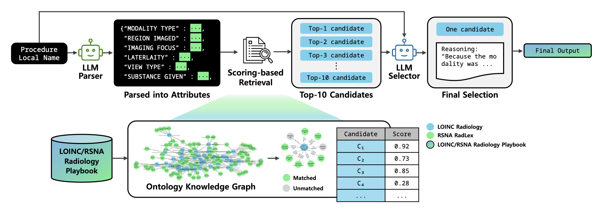

# ARKE (Automated Radiology Knowledge Encoding)

## Overview

ARKE standardizes local radiology procedure names into LOINC/RSNA Radiology Playbook codes. It decomposes each name into ontology-grounded attributes and matches them with the Playbook, using Large Language Models (LLMs) only for parsing and for the final selection.

LLM Parser
- Cleans and translates the procedure name, then structures it into the 18 Playbook attributes (JSON).

Scoring-based Retrieval
- Scores every Playbook code against the parsed attributes on the ontology knowledge graph, without an LLM, and keeps the Top-10.

LLM Selector
- Selects exactly one code from the Top-10 candidates with chain-of-thought reasoning.



<sub>Figure from Lee S, Jeon K, et al. ARKE: An ontology-driven framework for automated mapping of local radiology procedure terms to the LOINC-RadLex playbook using large language model. *J Biomed Inform*. 2026;180:105071. [doi:10.1016/j.jbi.2026.105071](https://doi.org/10.1016/j.jbi.2026.105071). Licensed under [CC BY-NC 4.0](https://creativecommons.org/licenses/by-nc/4.0/).</sub>

## Mapping Methods

Direct LOINC Mapping (baseline)
- Embeds the raw procedure name and the Playbook code names, and retrieves the Top-10 codes by embedding similarity without attributes.

Ontology-grounded Mapping
- Compares the parsed attributes of the input (A) with the attributes of each Playbook code (B) on the knowledge graph.
- `weighted` (default): Adds the weights of matched attributes and subtracts those of missing and extra attributes; clinically important attributes such as modality, region, laterality, view, and contrast weigh more.
- `jaccard`: Share of attributes in common, |A∩B| / |A∪B|.
- `match`: Number of matched attributes minus the numbers of missing and extra attributes (simple overlap).
- `f1`: Harmonic mean of precision (matched / A) and recall (matched / B).

## Features

- Automated standardization of local radiology procedure names to the LOINC/RSNA Radiology Playbook
- Ontology knowledge graph built from the Playbook (LOINC ↔ RadLex)
- LLM-based attribute parsing constrained to the Playbook schema
- Five attribute-based retrieval methods plus a direct embedding baseline
- LLM selection restricted to ontology-curated candidates
- Evaluation tools: Recall@k, MRR, NDCG@10, 95% confidence intervals, McNemar test
- Analysis tools: cohort characteristic comparison and attribute-wise agreement

## Requirements

- Python 3.9 or later
- OpenAI API key
- LOINC/RSNA Radiology Playbook CSV (`LoincRsnaRadiologyPlaybook_2025.csv`, available from [LOINC](https://loinc.org))
- Required Python packages (see `requirements.txt`)

## Installation

1. Clone the repository:
```bash
git clone https://github.com/1eetnals/ARKE.git
cd ARKE
```

2. Install dependencies:
```bash
pip install -r requirements.txt
```
   For the direct embedding baseline or the LCS method, also install the optional packages listed in `requirements.txt`.

3. Set up your OpenAI API key and the Playbook path:

   You can set them in one of two ways:

   a. Using environment variables:
   ```bash
   export OPENAI_API_KEY='your-api-key-here'
   export ARKE_PLAYBOOK_CSV='/path/to/LoincRsnaRadiologyPlaybook_2025.csv'
   ```

   b. Using a `.env` file in the project root (see `.env.example`):
   ```bash
   OPENAI_API_KEY=your-api-key-here
   ARKE_PLAYBOOK_CSV=/path/to/LoincRsnaRadiologyPlaybook_2025.csv
   ```
   The system loads the `.env` file automatically if it exists. The file is git-ignored.

## Usage

1. Prepare your data file (Excel format) with the following column:
   - `input_text`: Local radiology procedure name (another column can be chosen with `--column`)

2. Run the mapping:
```bash
python main.py run --input names.xlsx --method weighted --output result.xlsx
```

   Or run the stages one by one:
```bash
python main.py parse    --input names.xlsx --output parsed.xlsx
python main.py retrieve --input parsed.xlsx --method weighted --output candidates.xlsx
python main.py select   --input candidates.xlsx --output result.xlsx
```

3. Evaluate the results (requires a `LoincNumber` column with the reference code):
```bash
python main.py metrics --file weighted=result.xlsx --file direct=direct.xlsx
python main.py mcnemar --reference weighted=result.xlsx --file direct=direct.xlsx
python main.py overlap --file weighted=result.xlsx --file jaccard=jaccard.xlsx
```

4. Analyze the data:
```bash
python main.py extract   --input parsed.xlsx --output attributes.xlsx
python main.py compare   --a SEV=sev_attributes.xlsx --b SNUH=snuh_attributes.xlsx --output table.xlsx
python main.py agreement --input result.xlsx --playbook LoincRsnaRadiologyPlaybook_2025.csv
```

### Command Line Arguments

Mapping (`run | parse | retrieve | select`)
- `--input`: Path to the input Excel file (required)
- `--output`: Path to the output Excel file (required)
- `--column`: Procedure name column (default: `input_text`)
- `--method`: Retrieval method for `run` and `retrieve` — `weighted` (default), `jaccard`, `match`, `f1`, `lcs`, `direct`
- `--json-column`: Parser output column for `retrieve` (default: `input_text_json`)

Evaluation (`metrics | mcnemar | overlap`)
- `--file NAME=PATH`: Result file of one method (repeatable)
- `--reference NAME=PATH`: Reference method for `mcnemar`
- `--exclude-missing-gold`: Drop rows without a reference code
- `--output`: Excel file for the `metrics` table (optional)

Analysis (`extract | compare | summarize | region-focus | agreement`)
- `--a NAME=PATH`, `--b NAME=PATH`: The two cohorts for `compare`
- `--playbook`: Playbook CSV for `agreement`
- `--predicted`: Code compared in `agreement` — `top1` (default) or `map_loinc`

### Environment Variables

- `OPENAI_API_KEY`: OpenAI API key (required for the Parser, Selector, and embedding baseline)
- `ARKE_PLAYBOOK_CSV`: Playbook CSV path (default: `LoincRsnaRadiologyPlaybook_2025.csv`)
- `ARKE_CHAT_MODEL`: Chat model (default: `gpt-4o-2024-08-06`)
- `ARKE_EMBEDDING_MODEL`: Embedding model for the baseline (default: `text-embedding-ada-002`)
- `ARKE_IMAGING_CODES_CSV`: LOINC imaging codes for the baseline (default: `ImagingDocumentCodes_2025.csv`)
- `ARKE_RADLEX_OWL`: RadLex ontology for the LCS method (default: `Radlex.owl`)
- `ARKE_BATCH_SIZE`: Concurrent LLM calls per batch (default: `15`)

## Output Files

The mapping commands add the following columns to the input Excel file:

1. Parsing:
   - `input_text_json`: Procedure name structured into Playbook attributes

2. Retrieval:
   - `candidates`: Top-10 Playbook codes with scores and matched attributes
   - `filtered_candidates`: Top-10 codes with names and scores only

3. Selection:
   - `res`: LLM Selector answer including its reasoning
   - `map_loinc`: Selected LOINC code
   - `map_longname`: Selected Playbook code name

`metrics --output` writes a table of final Recall@1, Recall@1/3/5/10, MRR, and NDCG@10 with 95% confidence intervals for each method.

## System Architecture

For detailed information about the system, please refer to:
- [System Structure](documents/structure.md)
- [Business Rules](documents/business.md)
- [Flowcharts](documents/flowchart.md)
- [Data Objects](documents/dtos.md)
- [Glossary](documents/glossary.md)

## Development

```bash
ruff check . && ruff format --check .
pytest -q
```

Regression tests compare against saved experiment outputs and run only when `ARKE_DATA_DIR` points to the experiment data folder.

## Citation

```bibtex
@article{lee2026arke,
  title   = {ARKE: An ontology-driven framework for automated mapping of local radiology procedure terms
             to the LOINC-RadLex playbook using large language model},
  author  = {Lee, Sumin and Jeon, Kyulee and Lim, Joon Seok and Park, Yiju and Kim, Min Seong and
             Jin, Ju Hyun and Han, Chang Hoon and Yoon, Soon Ho and You, Seng Chan},
  journal = {Journal of Biomedical Informatics},
  volume  = {180},
  pages   = {105071},
  year    = {2026},
  doi     = {10.1016/j.jbi.2026.105071}
}
```

## Contributing

1. Fork the repository
2. Create your feature branch (`git checkout -b feature/AmazingFeature`)
3. Commit your changes (`git commit -m 'Add some AmazingFeature'`)
4. Push to the branch (`git push origin feature/AmazingFeature`)
5. Open a Pull Request

## Contact
SuminLee: lsm0801@yuhs.ac
