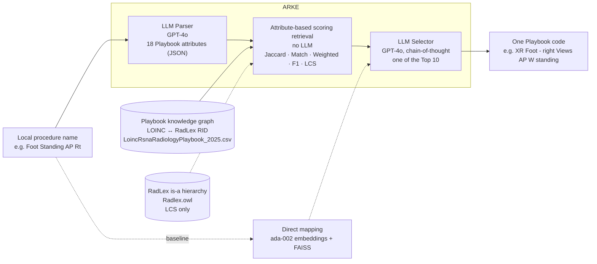
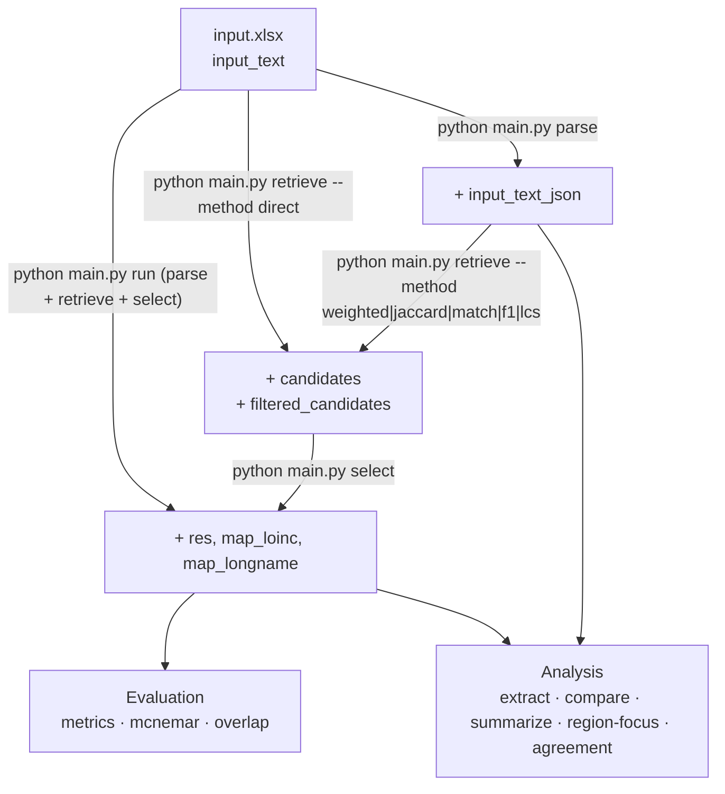
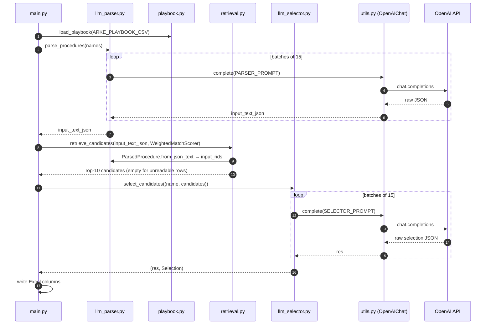
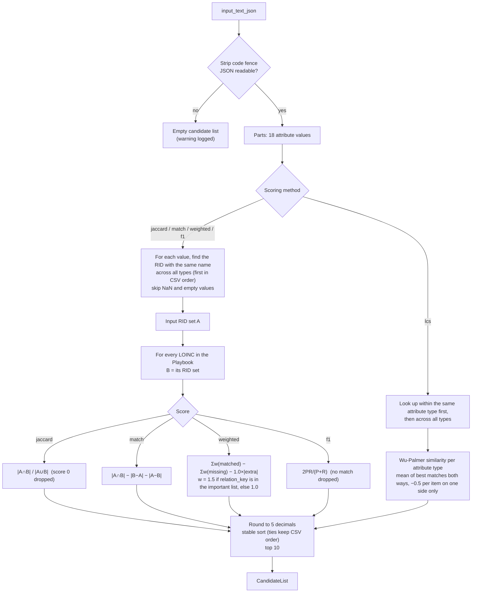
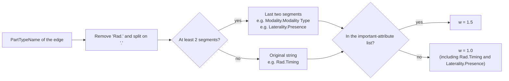
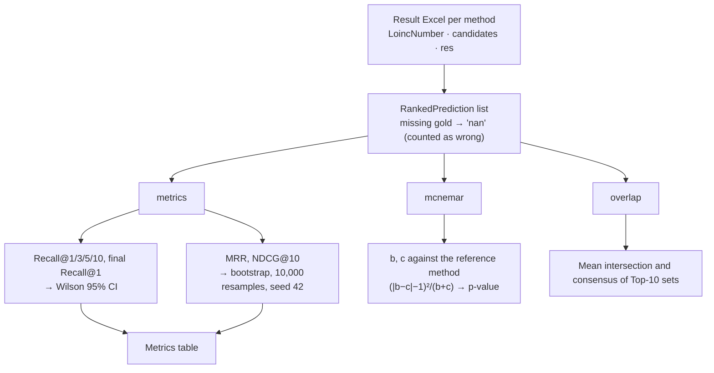
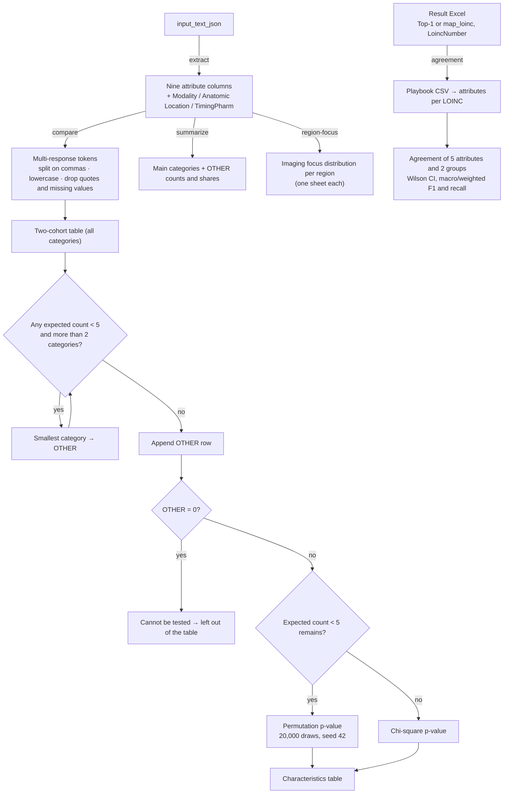

# Flowcharts

Mermaid diagrams of how data and calls flow. They render as diagrams on GitHub and in VS Code (with the Markdown Preview Mermaid Support extension).

## 1. ARKE pipeline (paper Fig. 1)

## 2. CLI stages and Excel columns

Each stage adds columns to the Excel file.

## 3. Module calls: `python main.py run --method weighted`

Solid arrows are calls and dashed arrows are returns.

## 4. Candidate retrieval (retrieval.py)

## 5. Weighted-matching weight

How `relation_key` makes Timing and Laterality Presence receive 1.0 (business.md, section 8, item 1).

## 6. Evaluation

## 7. Analysis

